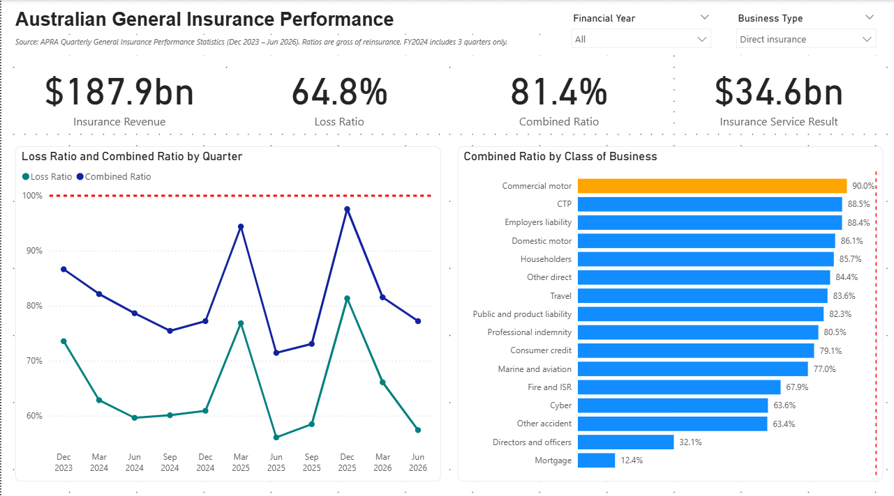
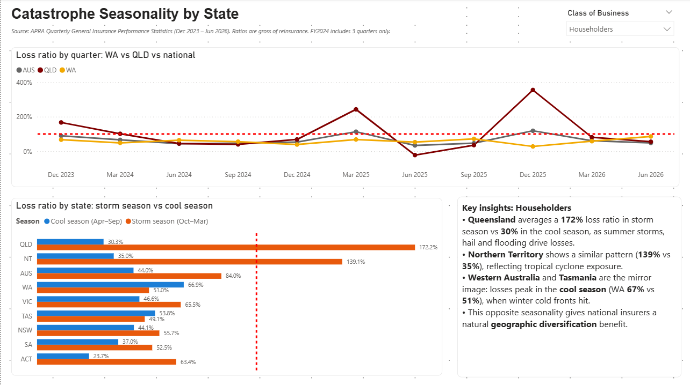
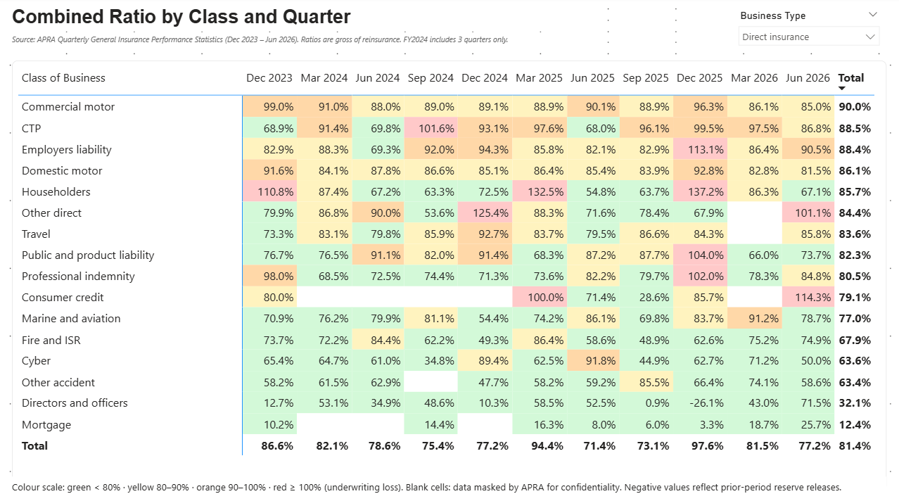
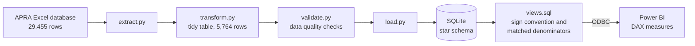

# Australian General Insurance Performance Dashboard

An end-to-end analytics project on APRA's quarterly general insurance statistics:
a reproducible **Python → SQLite → Power BI** pipeline that tracks loss ratios and
combined ratios across 18 classes of business, 8 states/territories and 11 quarters
(Dec 2023 – Jun 2026), and surfaces how natural catastrophe seasonality drives
underwriting results.



## Key insights

- **The direct insurance industry was profitable throughout the period.**
  Over the 11 quarters, direct insurers earned **$187.9bn** in insurance revenue at a
  **combined ratio of 81.4%** (loss ratio 64.8%), an insurance service result of
  **$34.6bn** before reinsurance.
- **Catastrophe seasonality is the main source of volatility.** The three worst
  quarters for the industry were Dec 2023, Mar 2025 and Dec 2025 (combined ratio
  up to 97.6%), all in the Oct–Mar storm season. **Dec 2025** alone had four classes
  with a combined ratio above 100%.
- **Queensland and Western Australia have opposite risk seasons.** For Householders,
  Queensland's loss ratio averaged **172%** in storm season vs **30%** in the cool
  season, while Western Australia peaked in the **cool season (67% vs 51%)**, driven
  by winter cold fronts. Tasmania follows the WA pattern. This is a natural
  geographic diversification benefit for national insurers.
- **Motor and long-tail classes run the thinnest margins.** Commercial motor (90.0%),
  CTP (88.5%) and Employers liability (88.4%) have the highest combined ratios,
  while Mortgage (12.4%) and Directors and officers (32.1%) have the lowest.

## Dashboard

| Page | Question it answers |
|---|---|
| **Overview** | Is the industry profitable, and how are ratios trending? |
| **Seasonality** | How do natural catastrophes affect each state across the year? |
| **Class Details** | Which classes made an underwriting loss, and when? |





## Architecture



The whole pipeline runs with one command and rebuilds the database from the raw file.

### Data model

A star schema with one fact table and four dimensions:

- `fact_cob_metric`: one row per quarter × class × state × metric (value, masking flag)
- `dim_quarter`: calendar quarter, Australian financial year (ending 30 June), labels
- `dim_class`: class of business, category (e.g. short-tail property, long-tail), group
- `dim_state`: states/territories plus a `National` row
- `dim_metric`: metric name and unit

Power BI reads `vw_fact_cob`, a wide view with one row per quarter × class × state.

## Methodology

**Definitions** (AASB 17 basis, gross of reinsurance):

| Metric | Formula |
|---|---|
| Loss ratio | Incurred claims ÷ Insurance revenue |
| Combined ratio | Insurance service expense ÷ Insurance revenue |
| Insurance service result | Insurance revenue − Insurance service expense |

Insurance service expense already **includes** incurred claims, alongside acquisition
costs, other expenses, onerous contract losses and changes to prior-period claims.

**Design decisions:**

- **AASB 17 series only.** APRA's statistics moved to the AASB 17 framework from
  1 July 2023 and are not comparable with earlier data. Quarterly flow data starts in
  Dec 2023, so the analysis covers 11 quarters and **FY2024 contains 3 quarters only**.
- **Ratio of sums, not average of ratios.** All ratios are calculated as total
  numerator ÷ total denominator for the selected period, so large quarters and
  classes are weighted correctly.
- **Matched denominators for masked data.** APRA masks some values (`*`) for
  confidentiality: 483 of 5,764 values (8.4%). Masked values are kept as `NULL`
  with an `is_masked` flag rather than replaced with zero. Revenue is only included
  in a ratio's denominator where the numerator for the same row is available,
  so masked values do not bias ratios downwards.
- **No double counting of states.** The fact table holds both national totals and
  state rows. DAX measures default to the national total unless a state is selected.
- **Sign convention in one place.** APRA reports expenses as negative numbers. They are
  stored as published and flipped once, in `sql/views.sql`.
- **Direct insurance by default.** The dashboard defaults to direct insurance, since
  adding inwards reinsurance would count part of the same risk twice.

## Data quality checks

`validate.py` stops the pipeline if any check fails:

1. Every APRA data item maps to a known metric.
2. No duplicate quarter × class × state × metric combinations.
3. Exactly 11 quarters of flow data.
4. **Reconciliation:** insurance revenue + insurance service expense equals APRA's own
   published insurance service result (187 class-quarters, within $1m rounding).

Ratios in Power BI were also cross-checked against the SQL views and an independent
pandas calculation in the exploration notebook.

## Project structure

```
├── data/
│   ├── raw/                  # APRA source files (unchanged)
│   └── processed/            # generated: tidy CSV and SQLite database (git-ignored)
├── notebooks/
│   └── 01_data_exploration.ipynb
├── src/
│   ├── extract.py            # load the APRA workbook
│   ├── transform.py          # tidy table, metric mapping, masking flag
│   ├── validate.py           # data quality checks
│   ├── load.py               # build the SQLite star schema
│   └── pipeline.py           # run everything end to end
├── sql/
│   ├── schema.sql            # star schema DDL
│   └── views.sql             # analytical views
└── dashboard/
    ├── apra_gi_dashboard.pbix
    └── *.png                 # dashboard screenshots
```

## How to reproduce

Requirements: Windows, Python 3.11+, Power BI Desktop, and the 64-bit
[SQLite ODBC driver](http://www.ch-werner.de/sqliteodbc/).

```powershell
git clone https://github.com/duogvuu/apra-general-insurance-dashboard.git
cd apra-general-insurance-dashboard
python -m venv .venv
.venv\Scripts\activate
pip install -r requirements.txt
python src/pipeline.py
```

Then open `dashboard/apra_gi_dashboard.pbix`. If your folder path differs, update the
database path under **Transform data → Data source settings → Change source**, and
click **Refresh**.

## Limitations

- **Gross of reinsurance.** Ratios do not reflect reinsurance recoveries.
- **Short history.** 11 quarters is too short to separate trend from catastrophe
  experience; one bad storm season can dominate a financial year.
- **Masked data.** Some small classes and state-level values are masked by APRA, so
  totals across classes are slightly incomplete.
- **Volatile small classes.** Quarterly ratios for small or long-tail classes can swing
  sharply, including negative values, due to prior-period reserve releases.
- **State figures cover revenue and claims only**, so only loss ratios (not combined
  ratios) are available by state.

## Data source and licence

Source: Australian Prudential Regulation Authority (APRA),
[Quarterly General Insurance Performance Statistics](https://www.apra.gov.au/quarterly-general-insurance-performance-statistics),
September 2023 to June 2026 edition, licensed under
[CC BY 3.0 AU](http://creativecommons.org/licenses/by/3.0/au/).
This project is independent and is not endorsed by APRA.

## Tech stack

Python (pandas) · SQLite · SQL (CTEs, conditional aggregation, views) ·
Power BI (Power Query, DAX, star schema) · Git